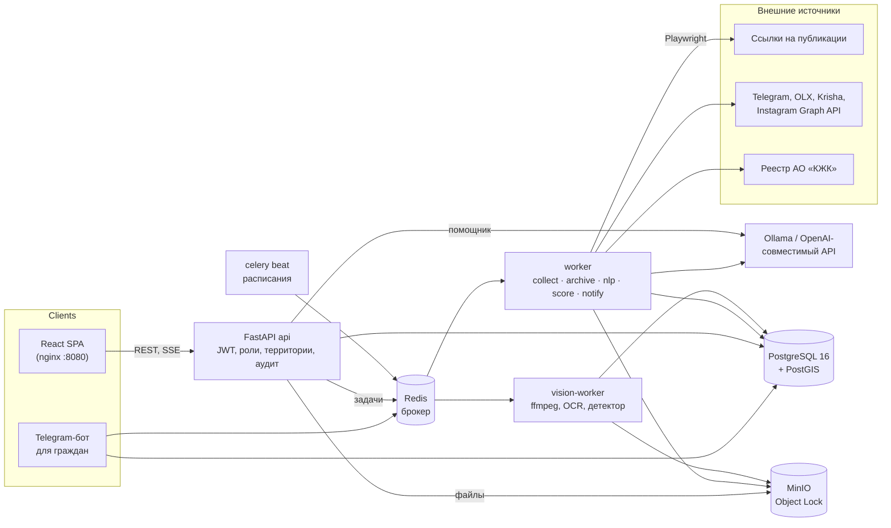
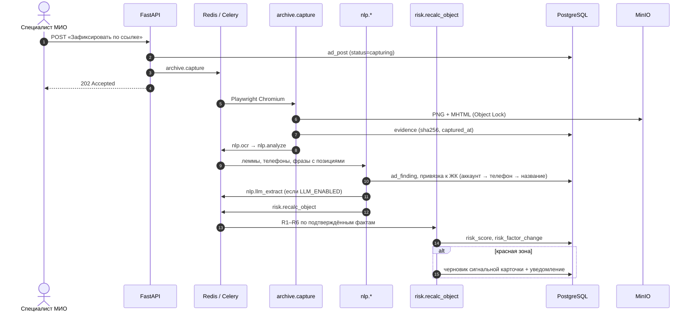
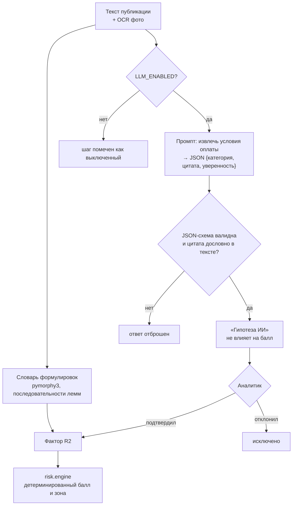

# SAQ QURYLYS

Платформа мониторинга рисков в долевом жилищном строительстве: собирает рекламу ЖК из соцсетей, сайтов и от
граждан, фиксирует её как неизменяемое доказательство, находит в тексте предложения внести деньги и считает
объяснимый балл риска по каждому объекту. Решение кейса Codemasters Hackathon 8.0 (Усть-Каменогорск, 2026).

**Проблема.** Специалист МИО вручную сводит рекламу квартир, реестр АО «КЖК», разрешения МИО, кадастр и обращения
граждан. Понять, какой ЖК проверять первым, долго, а объявление «внесите бронь» исчезает раньше, чем его зафиксируют.

**Решение.** Событийный конвейер: публикация → фиксация (PNG + MHTML, sha256, Object Lock) → OCR и лемматизация →
привязка к ЖК → детерминированный пересчёт балла R1–R6 → черновик сигнальной карточки для красной зоны. ИИ только
предлагает гипотезы; на балл влияет то, что подтвердил человек, и каждое решение по сигналу принимает человек.

> Красная зона означает высокий риск и необходимость проверки, а не установленную виновность.

## Технологический стек

| Категория | Технологии |
|---|---|
| **Core** | Python 3.12, FastAPI, SQLAlchemy 2, Alembic, Pydantic 2; Celery 5 + celery beat; React 19, TypeScript, Vite, Tailwind CSS 4, shadcn/ui, TanStack Query/Table, MapLibre GL, react-i18next (RU/KZ) |
| **Data** | PostgreSQL 16 + PostGIS, pg_trgm; Redis 7 (брокер Celery, счётчики входа); MinIO (S3 API, Object Lock) |
| **AI/ML** | pymorphy3 (лемматизация), rapidfuzz, phonenumbers; Tesseract OCR (rus+kaz+eng); Ollama + Qwen 3.5 9B (локально) или любой OpenAI-совместимый API; Grounding DINO tiny (SAQ VISION, экспериментально) |
| **Сбор и документы** | Playwright (Chromium), httpx, selectolax, python-telegram-bot, Telethon-юзербот; Jinja2 + WeasyPrint (PDF); RFC 3161 (опционально) |
| **Infra** | Docker Compose (профили для необязательных сервисов), nginx, Cloudflare Tunnel (опционально), NVIDIA runtime для GPU-профилей |

## Архитектура

### Системная схема

Модульный монолит на FastAPI плюс Celery-воркеры с отдельными очередями. Тяжёлые операции (браузер, OCR, LLM,
видео) вынесены из API в очереди, чтобы ответ пользователю не зависел от внешних площадок и модели.



- **Модули** — `backend/app/modules/<имя>/` (`router` / `service` / `schemas` / `tasks`): `objects`, `ads`, `nlp`,
  `risk`, `signals`, `evidence`, `graph`, `vision`, `assistant`, `search` и др. Celery сам находит `tasks.py`
  каждого модуля; сборщики — `backend/app/collectors/`, бот — `backend/app/bot/`.
- **Территория — атрибут данных** (область → город). Права проверяются в сервисном слое, чужая территория → 404;
  новые регионы подключаются данными, без кода.

### Конвейер публикации



### Интеграция ИИ

ИИ встроен как набор подсказок поверх детерминированного ядра: при выключенной модели система работает полностью.



- **Извлечение условий оплаты** — локальная Qwen 3.5 9B через Ollama: данные не покидают сервер. Ответ проверяется
  JSON-схемой, цитата обязана дословно найтись в тексте (защита от галлюцинаций).
- **Помощник «Спросить ИИ»** — агент с RAG по руководству сотрудника (`backend/app/modules/assistant/guide/`,
  поиск по леммам) и инструментами только на чтение с теми же правами и территорией, что и API. Ответ потоком (SSE)
  со ссылками на страницы. Подробнее — [docs/ASSISTANT.md](docs/ASSISTANT.md).
- **SAQ VISION** — кадры из видео облёта, OCR выделенных областей и детектор Grounding DINO без дообучения:
  только подсказки для человека. См. [docs/SAQ_VISION_ARCHITECTURE.md](docs/SAQ_VISION_ARCHITECTURE.md) и
  [docs/SAQ_VISION_EVAL.md](docs/SAQ_VISION_EVAL.md).

### Модель риска

Балл = min(100, сумма весов **подтверждённых** факторов). Неизвестные сведения дают 0 и выводятся в блоке «Нужна
проверка»: «нет данных» не равно «нет основания».

| Код | Фактор | Баллы |
|---|---|---|
| R1 | Проверены гарантия КЖК и разрешение МИО — оба не найдены | +35 |
| R2 | Прямое предложение внести деньги (бронь, депозит, взнос, рассрочка) | +25 |
| R3 | Активная реклама строящегося жилья за окно мониторинга (30 дней) | +10 |
| R4 | Подтверждённое коллективное обращение | +15 |
| R5 | Заявленная готовность расходится с фотофиксацией на ≥ 20 п.п. | +10 |
| R6 | Подтверждённый простой > 30 дней или просрочка ввода ≥ 90 дней | +5 |

Зоны: зелёная 0–24; жёлтая 25–59, а также 60+ без одновременных R1 и R2; красная — 60+ и одновременно R1 и R2.

### Architecture Decision Records

1. **Модульный монолит FastAPI + Celery вместо микросервисов.** Команда маленькая, домен один, транзакции
   пересекают модули (публикация → доказательство → балл → карточка). Один процесс API и одна схема БД упрощают
   согласованность и деплой; изоляция нагрузки достигается очередями Celery (`archive`, `nlp`, `vision` и др.), а не
   сетевыми границами. FastAPI выбран за async I/O для SSE помощника и типизированные контракты на Pydantic.
2. **Неизменяемость доказательств на трёх уровнях.** Файлы — в MinIO с Object Lock (`COMPLIANCE`, 1825 дней по
   умолчанию: не удалит даже root-ключ); `evidence`, `audit_log`, `risk_factor_change`, `ad_post_version` защищены
   триггерами от UPDATE/DELETE; сервисы ходят в БД ролью `APP_DB_USER` без этих прав, миграции — владельцем в
   одноразовом сервисе `migrate`. Без этого скриншот рекламы нельзя было бы использовать как материал проверки.
3. **Детерминированный скоринг, ИИ — только гипотезы.** Решение по сигналу юридически значимо, поэтому балл
   считается правилами R1–R6 с расшифровкой и ссылками на доказательства; одинаковые данные дают одинаковый
   результат. LLM работает локально (персональные данные не уходят наружу) и влияет на балл только после
   подтверждения человеком. PostgreSQL + PostGIS выбран вместо отдельного гео- и поискового хранилища: карта, pg_trgm
   и история баллов живут в одной транзакционной БД.

Контракт системы — [docs/SPEC.md](docs/SPEC.md), принятые решения — [docs/OPEN_QUESTIONS.md](docs/OPEN_QUESTIONS.md).

## Установка и запуск

Нужен Docker с Compose v2.

**1. Переменные окружения.**

```bash
cp .env.example .env
```

Значения по умолчанию из `.env.example` подходят для локального запуска (это dev-заглушки, не секреты):

```dotenv
POSTGRES_USER=saq
POSTGRES_PASSWORD=saq_dev_password
POSTGRES_DB=saq
APP_DB_USER=saq_app
APP_DB_PASSWORD=saq_app_dev_password
S3_ACCESS_KEY=saq-minio-dev
S3_SECRET_KEY=saq-minio-dev-secret
JWT_SECRET=dev-only-change-me-0123456789abcdef0123456789abcdef
INITIAL_ADMIN_PASSWORD=change-me-admin-password
DEMO_USER_PASSWORD=demo-saq-2026
```

Сервис базы данных в compose называется `db`: контейнеры подключаются к
`postgresql+psycopg://saq_app:saq_app_dev_password@db:5432/saq` (compose подставляет хосты `db`, `redis`, `minio`
сам). Для запуска backend на хосте БД опубликована на `localhost:5433`. Для продакшена задайте свои `JWT_SECRET`
(`openssl rand -hex 32`), пароли и уберите строки `EVIDENCE_LOCK_MODE=GOVERNANCE` / `EVIDENCE_RETENTION_DAYS=1`.

**2. Запуск.**

```bash
docker compose up -d --build                        # db, redis, minio, migrate, api, worker, beat, frontend
docker compose exec api python -m app.seed --demo   # справочники, пользователи и вымышленные данные
python3 scripts/verify_case_scenarios.py            # проверка сценариев A/B/C кейса
```

Откройте http://localhost:8080. API — http://localhost:8000/api/v1 (health: `/api/v1/health`).

| Пользователь | Пароль | Роль |
|---|---|---|
| `admin` | `INITIAL_ADMIN_PASSWORD` | администратор |
| `demo_mio` | `DEMO_USER_PASSWORD` | специалист МИО (основной сценарий) |
| `demo_gask` | `DEMO_USER_PASSWORD` | получатель ГАСК |
| `demo_police` | `DEMO_USER_PASSWORD` | правоохранительный орган |

`--demo` загружает 20 вымышленных ЖК, ~350 публикаций, обращения, сигнальные карточки во всех статусах, поручения и
сессии SAQ VISION. `--pilot` дополнительно импортирует 28 реальных строящихся ЖК Усть-Каменогорска из открытых
источников (только сведения о юрлицах и документах, без оценок).

**3. Необязательные сервисы** (compose-профили, всё выключено по умолчанию):

| Что | Настройка в `.env` | Команда |
|---|---|---|
| LLM-анализ и помощник (GPU NVIDIA) | `OLLAMA_URL=http://ollama:11434`, `LLM_ENABLED=true`, `ASSISTANT_ENABLED=true`, `ASSISTANT_BASE_URL=http://ollama:11434/v1` | `docker compose --profile llm-gpu up -d ollama` → `docker compose exec ollama ollama pull qwen3.5:9b-q6k` → `docker compose up -d api worker` |
| Telegram-бот для граждан | `TELEGRAM_BOT_TOKEN` от @BotFather | `docker compose --profile bot up -d bot` |
| Telegram-юзербот (чтение каналов) | `TELEGRAM_API_ID`, `TELEGRAM_API_HASH` с my.telegram.org, `COLLECT_TELEGRAM_ENABLED=true` | `docker compose --profile userbot run --rm userbot python -m app.userbot login`, затем `--profile userbot up -d userbot` |
| Сборщики OLX / Krisha / Instagram | `COLLECT_*_ENABLED=true`, `INSTAGRAM_GRAPH_TOKEN` | перезапуск `worker` и `beat` |
| SAQ VISION | `VISION_ENABLED=true`, `VISION_DETECTOR_BACKEND` | `docker compose --profile vision up -d vision-worker` (или `--profile vision-gpu`) |
| Публичный доступ | `CF_TOKEN` (Cloudflare Zero Trust → Tunnels, сервис `http://frontend:80`) | `docker compose --profile tunnel up -d tunnel` |

Помощник работает и через Gemini или Groq (`ASSISTANT_BASE_URL`, `ASSISTANT_API_KEY`) — [docs/ASSISTANT.md](docs/ASSISTANT.md).
Правила площадок и получение токенов — [docs/DATA_SOURCES.md](docs/DATA_SOURCES.md), справочник разработчика —
[docs/DEVELOPMENT.md](docs/DEVELOPMENT.md).

### Тестовый сценарий

| Кейс | Объект | Данные | Результат |
|---|---|---|---|
| A | «Северный бриз» | основание не проверено + платная бронь | R2 + R3 = **35, жёлтая**, «Нужна проверка: правовое основание» |
| B | «Золотая осень» | гарантия и разрешение МИО проверены и не найдены + «внесите депозит» | R1 + R2 + R3 = **70, красная**, черновик сигнальной карточки |
| C | «Тихая гавань» | гарантия КЖК подтверждена, обычная реклама | R3 = **10, зелёная** |

Сквозной путь под `demo_mio`: карта → фильтр красной зоны → «Золотая осень» → публикация с подсвеченным «внесите
депозит» → расшифровка балла (отклоните формулировку — балл пересчитается без R2) → сигнальная карточка → «Вернуть
на доработку» → «Подтвердить и направить» в ГАСК → PDF и журнал действий.

### Проверка качества

```bash
docker compose up -d db redis minio
cd backend && uv sync && uv run pytest                    # тесты на реальных PostgreSQL/PostGIS и MinIO
uv run ruff check . && uv run mypy app tests
cd ../frontend && pnpm install && pnpm typecheck && pnpm lint && pnpm build
```

### Известные ограничения

- У «Казреестра», разрешений МИО, кадастра и e-Otinish нет публичного API: проверка вносится вручную со
  скриншотом-доказательством. Реестр АО «КЖК» читается через публичный API, автосинхронизация выключена до
  согласования.
- OLX и Krisha отвечают небраузерным клиентам WAF-блокировкой; сборщики протестированы на синтетических страницах,
  подмену браузера система не делает. Instagram — только через официальный Graph API.
- Уверенность LLM плохо откалибрована, поэтому итоговое слово за аналитиком. Детектор SAQ VISION не дообучен.
- Границы районов приблизительные; казахский перевод требует вычитки носителем.

## Материалы

- **Питч:** https://youtu.be/WTm2HXy0VOM
- **Презентация:** не предоставляется
- **Live Demo:** не предоставляется (запуск локально — см. «Установка и запуск»)

## Данные и сторонние компоненты

Демо-данные вымышлены, настоящих персональных данных в seed нет. Открытые данные: производственный календарь РК,
OpenStreetMap (ODbL), набор Казреестра «Объекты с долевым участием» (CC BY 3.0 NZ) — подробности в
[docs/DATA_SOURCES.md](docs/DATA_SOURCES.md). Лицензии компонентов, шрифтов и моделей —
[THIRD_PARTY_NOTICES.md](THIRD_PARTY_NOTICES.md); вид интерфейса — [docs/UI.md](docs/UI.md).
