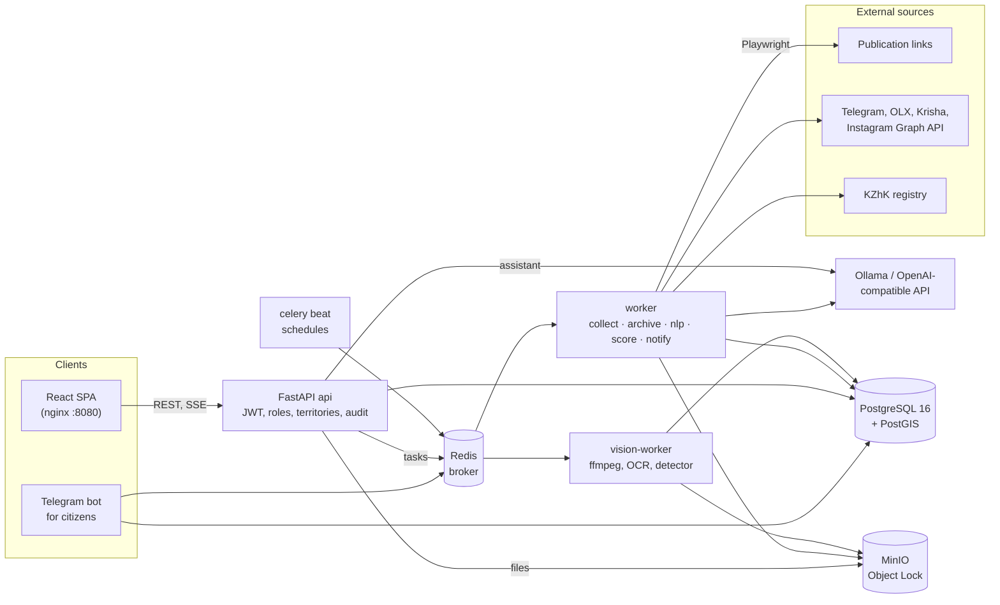
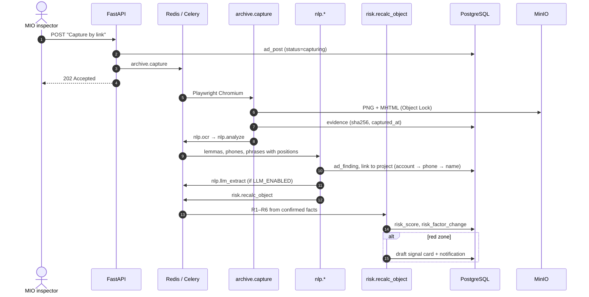
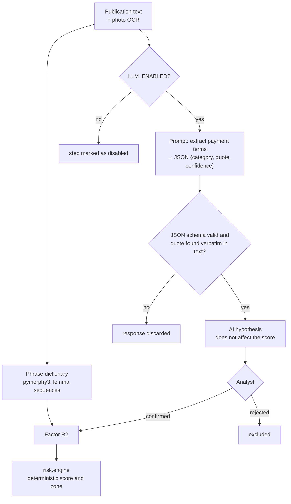

<div align="center">


<h1>SAQ QURYLYS — Construction-Risk Monitoring</h1>
<hr>

**Risk monitoring for municipal inspectors in one place: tamper-evident evidence, deterministic R1–R6 scoring, human-confirmed AI findings**


[Architecture](#architecture) · [Setup](#setup--deployment) · [Demo video](https://youtu.be/3RoOg2nhx4Y) · [Pitch](https://youtu.be/WTm2HXy0VOM)

English · [Русский](README.ru.md)

</div>

## What it is

A monitoring platform for shared-equity housing construction in Kazakhstan, built as a Codemasters 8.0 case. A municipal inspector (MIO) used to reconcile apartment advertising, the KZhK registry, MIO permits, the cadastre and citizen complaints by hand, and a "pay a deposit" ad could vanish before anyone captured it.

The system captures advertising from social networks, websites and citizens as immutable evidence, finds payment offers in the text, and computes an explainable risk score per construction project. AI only proposes hypotheses; the final decision on every signal is made by a person.

> [!NOTE]
> The red zone means high risk and a need for inspection, not established guilt.

## Highlights

- **110 REST endpoints** on a FastAPI modular monolith, 11 Alembic migrations, per-queue Celery routing.
- **Deterministic 6-factor risk engine (R1–R6):** the same confirmed input always gives the same score. LLM findings count only after analyst confirmation.
- **Tamper-evident evidence:** sha256-hashed PNG + MHTML captures in MinIO Object Lock, plus append-only PostgreSQL triggers.
- **1,068 pytest tests** (812 of them on real PostGIS and MinIO) and **65 Playwright E2E** tests.

**Role:** solo developer of the whole system (backend, React frontend, Docker setup, tests, docs), built with AI-assisted tooling for the Codemasters 8.0 case.

## Technical Stack

| Category | Technologies |
|---|---|
| **Core** | Python 3.12, FastAPI, SQLAlchemy 2, Alembic, Pydantic 2; Celery 5 + celery beat; React 19, TypeScript, Vite, Tailwind CSS 4, shadcn/ui, TanStack Query/Table, MapLibre GL, react-i18next (RU/KZ) |
| **Data** | PostgreSQL 16 + PostGIS, pg_trgm; Redis 7 (Celery broker, login counters); MinIO (S3 API, Object Lock) |
| **AI/ML** | pymorphy3 (lemmatization), rapidfuzz, phonenumbers; Tesseract OCR (rus+kaz+eng); Ollama + Qwen 3.5 9B (local) or any OpenAI-compatible API; Grounding DINO tiny (SAQ VISION, experimental) |
| **Capture & documents** | Playwright (Chromium), httpx, selectolax, python-telegram-bot, Telethon userbot; Jinja2 + WeasyPrint (PDF); RFC 3161 (optional) |
| **Infra** | Docker Compose (profiles for optional services), nginx, Cloudflare Tunnel (optional), NVIDIA runtime for GPU profiles |
| **Tests** | pytest, ruff, mypy, ESLint, Playwright E2E |

## Architecture

### System diagram

A FastAPI modular monolith plus Celery workers on separate queues. Heavy work (browser, OCR, LLM, video) runs in queues, so an API response does not depend on external sites or the model.



- **Modules** live in `backend/app/modules/<name>/` (`router` / `service` / `schemas` / `tasks`): `objects`, `ads`, `nlp`, `risk`, `signals`, `evidence`, `graph`, `vision`, `assistant`, `search` and others. Celery discovers each module's `tasks.py`; collectors are in `backend/app/collectors/`, the bot in `backend/app/bot/`.
- **Territory is a data attribute** (oblast → city). Access is checked in the service layer and a foreign territory returns 404, so new regions are added as data, without code.

### Publication pipeline



### AI integration

AI is a layer of suggestions over a deterministic core: with the model switched off, the system works in full.



- **Payment-term extraction:** local Qwen 3.5 9B via Ollama, so data stays on the server. The answer is checked against a JSON schema and the quote must appear verbatim in the text (hallucination guard).
- **"Ask AI" assistant:** an agent with RAG over the staff guide (`backend/app/modules/assistant/guide/`, lemma search) and read-only tools bound to the same permissions and territory as the API. Answers stream over SSE with page links. See [docs/ASSISTANT.md](docs/ASSISTANT.md) (Russian).
- **SAQ VISION:** frames from flyover video, OCR of selected regions and a zero-shot Grounding DINO detector; hints for a human only. See [docs/SAQ_VISION_ARCHITECTURE.md](docs/SAQ_VISION_ARCHITECTURE.md) and [docs/SAQ_VISION_EVAL.md](docs/SAQ_VISION_EVAL.md) (Russian).

### Risk model

Score = min(100, sum of weights of **confirmed** factors). Unknown facts add 0 and are listed under "Needs verification": "no data" is not "no grounds".

| Code | Factor | Points |
|---|---|---|
| R1 | KZhK guarantee and MIO permit checked, neither found | +35 |
| R2 | Direct offer to pay money (reservation, deposit, fee, installments) | +25 |
| R3 | Active advertising of a building under construction in the monitoring window (30 days) | +10 |
| R4 | Confirmed collective complaint | +15 |
| R5 | Declared readiness differs from photo evidence by ≥ 20 pp | +10 |
| R6 | Confirmed standstill > 30 days or commissioning delay ≥ 90 days | +5 |

Zones: green 0–24; yellow 25–59, and also 60+ without both R1 and R2; red 60+ with both R1 and R2.

### Architecture Decision Records

1. **FastAPI + Celery modular monolith instead of microservices.** One small team, one domain, and transactions that cross modules (publication → evidence → score → card). One API process and one DB schema keep consistency and deployment simple; load isolation comes from Celery queues (`archive`, `nlp`, `vision` and others), not network boundaries. FastAPI gives async I/O for the assistant's SSE and typed Pydantic contracts.
2. **Evidence immutability on three levels.** Files go to MinIO with Object Lock (`COMPLIANCE`, 1825 days by default: not even the root key can delete them). `evidence`, `audit_log`, `risk_factor_change` and `ad_post_version` are protected by triggers against UPDATE/DELETE. Services connect with the `APP_DB_USER` role that lacks those rights, while migrations run as the owner in a one-shot `migrate` service. Without this, an ad screenshot could not serve as inspection material.
3. **Deterministic scoring, AI only for hypotheses.** A decision on a signal is legally significant, so the score comes from R1–R6 rules with an explanation and links to evidence. The LLM runs locally (personal data stays in) and changes the score only after human confirmation. PostgreSQL + PostGIS replaces separate geo and search stores: map, pg_trgm and score history live in one transactional DB.

The system contract is in [docs/SPEC.md](docs/SPEC.md), decisions taken in [docs/OPEN_QUESTIONS.md](docs/OPEN_QUESTIONS.md) (both in Russian).

## Project Structure

```text
.
├── backend/
│   ├── app/
│   │   ├── modules/       # domain modules: router / service / schemas / tasks
│   │   ├── collectors/    # Telegram, OLX, Krisha, Instagram collectors
│   │   ├── bot/           # Telegram bot for citizens
│   │   └── seed_data/     # demo and pilot datasets
│   ├── alembic/           # 11 migrations, append-only triggers
│   └── tests/             # pytest suite on real PostGIS and MinIO
├── frontend/
│   ├── src/               # React SPA
│   └── e2e/               # Playwright E2E specs
├── docs/                  # SPEC, assistant, SAQ VISION, data sources, dev guide (Russian)
├── scripts/               # verify_case_scenarios.py
├── docker-compose.yml     # db, redis, minio, migrate, api, worker, beat, frontend + profiles
└── .env.example           # dev defaults
```

## Setup & Deployment

Requires Docker with Compose v2.

**1. Environment.**

```bash
cp .env.example .env
```

The `.env.example` defaults suit a local run (dev placeholders, not secrets):

```dotenv
POSTGRES_USER=saq
POSTGRES_PASSWORD=saq_dev_password
POSTGRES_DB=saq
APP_DB_USER=saq_app
APP_DB_PASSWORD=saq_app_dev_password
S3_ACCESS_KEY=saq-minio-dev
S3_SECRET_KEY=saq-minio-dev-secret
JWT_SECRET=dev-only-change-me-0123456789abcdef0123456789abcdef
INITIAL_ADMIN_PASSWORD=change-me-admin-password
DEMO_USER_PASSWORD=demo-saq-2026
```

The database service in compose is called `db`: containers connect to `postgresql+psycopg://saq_app:saq_app_dev_password@db:5432/saq` (compose injects the `db`, `redis`, `minio` hosts itself). To run the backend on the host, the DB is published on `localhost:5433`.

> [!WARNING]
> For production set your own `JWT_SECRET` (`openssl rand -hex 32`) and passwords, and remove the `EVIDENCE_LOCK_MODE=GOVERNANCE` / `EVIDENCE_RETENTION_DAYS=1` lines, which exist so dev data can be deleted.

**2. Run.**

```bash
docker compose up -d --build                        # db, redis, minio, migrate, api, worker, beat, frontend
docker compose exec api python -m app.seed --demo   # reference data, users and fictional demo data
python3 scripts/verify_case_scenarios.py            # check case scenarios A/B/C
```

Open http://localhost:8080. API: http://localhost:8000/api/v1 (health: `/api/v1/health`).

| User | Password | Role |
|---|---|---|
| `admin` | `INITIAL_ADMIN_PASSWORD` | administrator |
| `demo_mio` | `DEMO_USER_PASSWORD` | MIO inspector (main scenario) |
| `demo_gask` | `DEMO_USER_PASSWORD` | GASK recipient |
| `demo_police` | `DEMO_USER_PASSWORD` | law enforcement |

`--demo` loads fictional housing complexes, publications, complaints, signal cards in every status, assignments and SAQ VISION sessions. `--pilot` additionally imports real under-construction projects of Ust-Kamenogorsk from open sources (legal-entity and document data only, no assessments).

<details>
<summary>Optional services (compose profiles, all off by default)</summary>

| What | `.env` settings | Command |
|---|---|---|
| LLM analysis and assistant (NVIDIA GPU) | `OLLAMA_URL=http://ollama:11434`, `LLM_ENABLED=true`, `ASSISTANT_ENABLED=true`, `ASSISTANT_BASE_URL=http://ollama:11434/v1` | `docker compose --profile llm-gpu up -d ollama` → `docker compose exec ollama ollama pull qwen3.5:9b-q6k` → `docker compose up -d api worker` |
| Telegram bot for citizens | `TELEGRAM_BOT_TOKEN` from @BotFather | `docker compose --profile bot up -d bot` |
| Telegram userbot (channel reading) | `TELEGRAM_API_ID`, `TELEGRAM_API_HASH` from my.telegram.org, `COLLECT_TELEGRAM_ENABLED=true` | `docker compose --profile userbot run --rm userbot python -m app.userbot login`, then `--profile userbot up -d userbot` |
| OLX / Krisha / Instagram collectors | `COLLECT_*_ENABLED=true`, `INSTAGRAM_GRAPH_TOKEN` | restart `worker` and `beat` |
| SAQ VISION | `VISION_ENABLED=true`, `VISION_DETECTOR_BACKEND` | `docker compose --profile vision up -d vision-worker` (or `--profile vision-gpu`) |
| Public access | `CF_TOKEN` (Cloudflare Zero Trust → Tunnels, service `http://frontend:80`) | `docker compose --profile tunnel up -d tunnel` |

The assistant also works through Gemini or Groq (`ASSISTANT_BASE_URL`, `ASSISTANT_API_KEY`), see [docs/ASSISTANT.md](docs/ASSISTANT.md). Platform rules and token setup: [docs/DATA_SOURCES.md](docs/DATA_SOURCES.md); developer reference: [docs/DEVELOPMENT.md](docs/DEVELOPMENT.md).

</details>

### Test scenario

| Case | Project | Data | Result |
|---|---|---|---|
| A | "Severny Briz" | legal basis not checked + paid reservation | R2 + R3 = **35, yellow**, "Needs verification: legal basis" |
| B | "Zolotaya Osen" | guarantee and MIO permit checked and not found + "pay a deposit" | R1 + R2 + R3 = **70, red**, draft signal card |
| C | "Tikhaya Gavan" | KZhK guarantee confirmed, ordinary ad | R3 = **10, green** |

End-to-end path as `demo_mio`: map → red-zone filter → "Zolotaya Osen" → publication with the highlighted "pay a deposit" → score breakdown (reject the phrase and the score is recalculated without R2) → signal card → "Return for revision" → "Confirm and send" to GASK → PDF and action log.

### Quality checks

```bash
docker compose up -d db redis minio
cd backend && uv sync && uv run pytest                    # tests on real PostgreSQL/PostGIS and MinIO
uv run ruff check . && uv run mypy app tests
cd ../frontend && pnpm install && pnpm typecheck && pnpm lint && pnpm build
```

### Known limitations

- Kazreestr, MIO permits, the cadastre and e-Otinish have no public API: checks are entered manually with a screenshot as evidence. The KZhK registry is read through a public API; auto-sync is off until agreed.
- OLX and Krisha answer non-browser clients with a WAF block; collectors are tested on synthetic pages and the system does not spoof a browser. Instagram works only through the official Graph API.
- LLM confidence is poorly calibrated, so the analyst has the last word. The SAQ VISION detector is not fine-tuned.
- District borders are approximate; the Kazakh translation needs a native speaker's review.
- No CI pipeline and no frontend unit tests; E2E covers the UI.

## Data & Third-Party Components

Demo data is fictional; the seed contains no real personal data. Open data: the Kazakhstan production calendar, OpenStreetMap (ODbL), the Kazreestr dataset "Objects with shared participation" (CC BY 3.0 NZ), see [docs/DATA_SOURCES.md](docs/DATA_SOURCES.md). Licenses of components, fonts and models: [THIRD_PARTY_NOTICES.md](THIRD_PARTY_NOTICES.md). UI overview: [docs/UI.md](docs/UI.md).

## License

Proprietary, all rights reserved. The source is published for viewing only, see [LICENSE](LICENSE).
